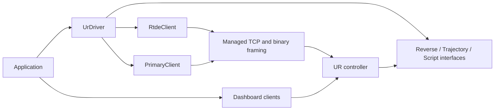

# UniversalRobotsClient.NET

Managed .NET Standard 2.0 clients for Universal Robots RTDE, primary, dashboard, and external-control interfaces.

This is a preview implementation. Use the API reference for XML summaries, the compatibility page for verified behavior and gaps, and the repository README for build and read-only RTDE examples.

## Data Flow

RTDE joint positions are radians. TCP pose consists of translation in metres and an axis-angle rotation vector in radians, relative to the robot base. Windows/.NET scheduling is not a substitute for a safety controller or a hard-real-time kernel.